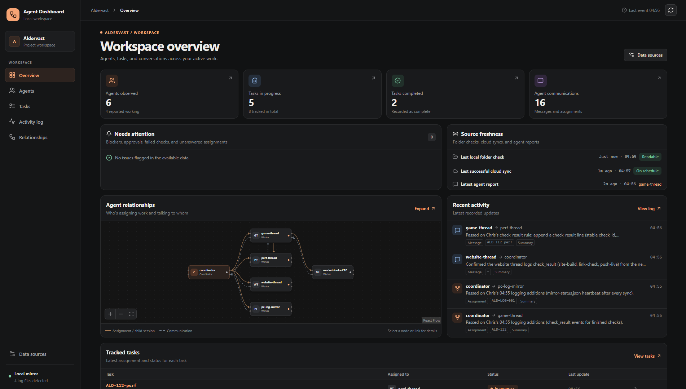

# Agent Dashboard

A local web dashboard for agent workflows. Follow assignments and task status, search agent messages and activity, and explore delegation and communication in an interactive graph. It works with any harness that writes the [activity log format](docs/activity-log.md) and can also read from a local OpenCode V2 server.



*Aldervast is the example workspace shown above. You can connect your own project.*

## Getting started

Requires Node.js 22.12 or newer.

```sh
git clone https://github.com/sentrychris/agent-dashboard.git
cd agent-dashboard
npm ci
npm run dev
```

1. Create a local folder for your project's activity logs. For a first run, save the two [example JSONL files](docs/activity-log.md#example-project) in that folder.
2. Open [http://127.0.0.1:4317](http://127.0.0.1:4317), open the project switcher in the sidebar, then select **Add project**. Enter a name and the folder's absolute path under **Local log folder**.
3. Have your agents or an integration append real events to that folder using the [JSONL schema](docs/activity-log.md). If your agents write logs in the cloud, mirror those files to the local folder.

The dashboard checks the selected project's folder every three seconds and discovers new `.jsonl` files automatically. Use a separate folder for each project. The switcher remembers your last selection, and **Data sources** edits the selected project's name, folder, and OpenCode connection.

Existing single-project settings are imported automatically. A fresh setup starts with the Aldervast example configuration, which you can edit or keep alongside your other projects.

To serve a built copy, run `npm run build` and then `npm start`.

## Monitoring

- **Task briefs** show the latest status report and the most recent result for each named check on a task. Agents can optionally add [a blocker, next action, and verification](docs/activity-log.md#structured-task-updates) to make those details easy to scan.
- **Conversation** in a task shows assignments, replies, and status updates oldest first, with verbatim messages and summaries labeled. Switch to **All activity** for every task event, including checks and tool activity.
- **Copy handoff** in the task brief builds a prompt for another agent session from the assignment, status, recent conversation, and recorded checks. It marks missing details and preserves the distinction between verbatim messages and summaries.
- **Continue in OpenCode** lets you review the handoff and confirm the worktree configured in **Data sources** before opening a draft in OpenCode Desktop. It uses the registered local service. Longer handoffs are copied for pasting into the draft. Keep the handoff heading, task, and handoff ID in the first message so the dashboard can identify the session.
- **Handoff history** shows when a draft was requested, which OpenCode session picked it up, and the status of that session when it’s visible to the dashboard. It shows task reports and checks recorded after pickup, up to the next pickup on the same task. An idle session alone does not mark the task complete. Draft requests and pickups are saved locally in `.dashboard/handoffs.json`.
- **Needs attention** shows blocked or failed tasks, pending OpenCode approvals, and queued assignments with no acknowledgement after 30 minutes. Agents can also report [failed and passing checks](docs/activity-log.md#reporting-check-results) so a failure stays visible until it passes or the task closes. Select an item to open its source event or session.
- **Source freshness** shows when the dashboard last checked the local folder, when it last checked the OpenCode API for direct connections, and when the most recent agent report was recorded. If you use a cloud mirror, have it write [`mirror-status.json`](docs/activity-log.md#cloud-mirror-heartbeat) in the local activity folder after each attempt, including successful runs that copy zero lines.

Existing JSONL files still work as-is. Check results and cloud mirror heartbeats are optional. A direct OpenCode connection can report its freshness without a heartbeat.

## Optional: connect OpenCode V2

In **Data sources**, enter the URL of a reachable loopback OpenCode V2 API. Set **Project directory** if the OpenCode workspace is somewhere other than the parent of your log folder. The dashboard reads recent sessions, their last 30 messages, tool activity, and pending approvals.

`http://127.0.0.1:4096` is an example address. For the registered local OpenCode service, use the exact URL printed by `opencode service status`; the dashboard uses OpenCode’s local authentication automatically. For another local server that requires an `Authorization` header, set `DASHBOARD_OPENCODE_AUTHORIZATION` before launching the dashboard. Leave the URL blank to use only your activity logs.

To link a session to a task, include a full task ID already present in the selected project's logs in the session title (for example, `WEB-42 — Fix sidebar`). You can also set the session's `metadata.task_id` explicitly; metadata takes priority and works even before the task appears in the logs.

The dashboard listens on loopback and saves source settings in `.dashboard/settings.json`. Agent statuses derived from logs reflect the latest report and may lag real activity.
